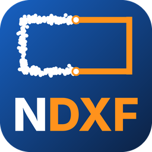

# Nuvola2DXF (NDXF)



Programma per Windows che trasforma le nuvole di punti dei laser scanner in
**piante, sezioni e prospetti in DXF**, con le linee ricostruite in modo da
seguire il più possibile i limiti rilevati e gli elementi già divisi per layer.

Esempio: 10.000 punti che descrivono il perimetro di una stanza diventano
**una polilinea chiusa di 4 lati**, con gli spigoli uniti esattamente negli angoli.

## Cosa fa

- **Formati**: LAS, LAZ, E57, PTS, PTX, XYZ / TXT / ASC / CSV, PLY (quelli
  esportati da Trimble RealWorks, Leica Cyclone, Faro Scene, ecc.).
- **File grandi (1–10 GB e oltre)**: alla prima apertura la nuvola viene
  convertita una volta sola in un formato veloce su disco; poi ogni taglio
  legge solo i punti che servono, con poca memoria. Riaprire lo stesso file è
  immediato.
- **Pianta**: taglio orizzontale a una quota (il grafico delle quote propone
  pavimento + 1 m).
- **Sezione**: taglio verticale lungo una linea A-B tracciata sulla vista
  dall'alto.
- **Prospetto**: facciata vista di fronte; la linea si allinea da sola alla
  facciata, i vani nella superficie diventano finestre e porte, le parti
  sporgenti (balconi, cornici) vanno negli aggetti.
- **Tre modi di ricostruire le linee** secondo il tipo di edificio:
  - *Squadrato*: linee dritte, angoli quasi retti portati a 90°, spigoli uniti;
  - *Prevalentemente dritto*: linee dritte e parallele, angoli liberi;
  - *Storico / irregolare*: segue il contorno con tratti dritti, archi e
    cerchi (absidi, colonne, volte, nicchie, murature irregolari);
  - *Tabià / strutture in legno*: segue anche gli elementi sottili (tavole da
    2–4 cm a doppia linea), travi e puntoni inclinati, e mette tavolati, travi
    e ballatoi su layer separati, oltre alle murature in pietra.
- **Stanze chiuse**: oltre ai punti nella fascia di tolleranza entrano nella
  linea anche quelli vicini (entro 1 cm, regolabile); gli angoli nascosti da
  mobili e i buchi lungo i muri vengono richiusi (fino a 1 m). Le chiusure
  oltre i 10 cm vanno nel layer `00_chiusure_da_verificare`, di colore
  diverso, da controllare in CAD. Le soglie seguono la densità dei punti di
  ogni muro (vicino allo scanner milioni di punti, sulle pareti lontane
  molti meno).
- **Riconoscimento degli elementi** (layer modificabili):
  `00_muri`, `00_porte`, `00_finestre`, `00_pilastri`, `00_pavimenti`,
  `00_soffitti`, `00_solai`, `00_coperture`, `00_volte_archi`, `00_aggetti`,
  `00_legno_tavolati`, `00_legno_travi`, `00_legno_ballatoi`,
  `00_chiusure_da_verificare`, `00_arredi`.
  In pianta i vani sono le interruzioni simili sulle due facce del muro: per
  ognuno il programma fa da solo una sezione verticale nella nuvola 3D e
  misura pavimento, soglia o davanzale e architrave (una porta parte dal
  pavimento, una finestra ha il davanzale); nel DXF le misure, per esempio
  «P 90×210» o «F 120×120 dav. 90». In sezione si riconoscono pavimento
  (base), soffitto, architravi, davanzali e le porte anche con l'anta chiusa.
- **Due metodi di ricostruzione** (pianta): *matematico*, fedele ai punti del
  taglio; *intuitivo*, che guarda tutta la nuvola come una persona che si
  guarda attorno: trova pavimento e soffitto, ricava i muri dalla fascia sotto
  il soffitto (dove non ci sono mobili), guarda ogni muro per intero per porte
  e finestre (un oggetto davanti non è un vano; controllo anche dall'altro
  lato del muro) e chiude le stanze.
- **Locali**: ogni stanza è un contorno chiuso con nome e superficie (layer
  `00_locali`), agganciato ai muri; i lati senza muro diventano chiusure sul
  prolungamento dei muri, fino agli spigoli geometrici.
- **Anteprima del taglio**: prima di estrarre si vedono solo i punti che il
  taglio prenderà (sulla vista dall'alto e da soli), con la stima dei punti;
  vista 3D assonometrica con il piano di taglio; anteprima precisa a piena
  risoluzione, riusata dall'estrazione.
- **Controlli con la nuvola 3D** (pianta): gli arredi alti (armadi,
  frigoriferi, librerie) finiscono sotto il soffitto e dietro hanno un muro:
  vanno nel layer `00_arredi` e il muro dietro si richiude; i vani dei muri
  rilevati da un solo lato (muri esterni visti da dentro) si riconoscono
  dall'architrave e dal davanzale, con la luce netta anche se strombati;
  persone e piccoli oggetti isolati vanno in `00_altro`.
- **Banco di prova** (`tests/banco_prova`, solo per sviluppo): simulatore di
  laser scanner su edifici di prova con pianta nota, per misurare gli errori.
- **Più tagli, file separati**: ogni pianta, sezione o prospetto estratto si
  aggiunge a un elenco; si rinomina con un doppio clic («Sezione A-A»,
  «Prospetto nord»: per i prospetti l'orientamento è proposto in automatico) e
  «Esporta tutti» salva un DXF per ogni taglio con il suo nome.
- **Analisi del fuori piombo** (facoltativa): per pareti e pilastri misura la
  posizione reale della superficie ogni 25 cm di altezza (regolabile) rispetto
  alla verticale passante per la base. Nel DXF: verticale teorica tratteggiata,
  profilo reale ingrandito (es. 10×), valori in cm e riepilogo; in più un
  report CSV apribile in Excel.
- **DXF** (AutoCAD 2010, metri): le piante hanno le coordinate reali del
  rilievo; sezioni e prospetti hanno X = distanza da A e Y = quota reale.
  Polilinee unite (con archi) oppure linee/archi separati; facoltativamente i
  punti della fetta su un layer a parte.

Gli errori di riconoscimento si correggono nel programma CAD: il DXF è già
diviso per layer.

## Scaricare il programma

Le versioni pronte (`Nuvola2DXF.exe`, un solo file, nessuna installazione)
sono nella pagina **Releases** del repository (voce *Nuvola2DXF*), oppure tra
gli *Artifacts* della compilazione automatica "Nuvola2DXF" (scheda Actions).

Requisiti: `Nuvola2DXF.exe` per Windows 10 o 11 a 64 bit;
`Nuvola2DXF-Windows7.exe` per Windows 7 e 8.1 a 64 bit (Python 3.8 e Qt5, stesse
funzioni; va bene anche su Windows 10/11). Al primo avvio Windows può mostrare un
avviso: «Ulteriori informazioni» → «Esegui comunque».

Le nuvole convertite sono conservate in `%LOCALAPPDATA%\Nuvola2DXF\cache`
(circa 12 byte per punto: 300 milioni di punti ≈ 3,6 GB); si svuota dal
pulsante «Svuota archivio temporaneo».

## Uso

1. **Apri nuvola** (o trascina il file nella finestra).
2. Scegli **Pianta**, **Sezione** o **Prospetto**; per sezione e prospetto
   traccia A e B sulla vista dall'alto.
3. Scegli il **tipo di edificio** (eventualmente le «Regolazioni fini») e, se
   serve, l'**analisi fuori piombo**.
4. **Taglia ed estrai le linee**: il taglio si aggiunge all'elenco «Tagli e
   DXF» a destra. Ripeti per tutte le piante, sezioni e prospetti che servono,
   rinominali con un doppio clic ed esportali (**Esporta tutti** = un DXF per
   taglio).

## Per sviluppatori

```
pip install -r requirements.txt
python Nuvola2DXF.py                 # avvia il programma
pip install pytest && pytest tests   # test automatici
python tests/genera_esempi.py esempi # nuvole di prova (LAS, LAZ, PTS)
pyinstaller --noconfirm Nuvola2DXF.spec   # crea dist/Nuvola2DXF.exe
dist/Nuvola2DXF.exe --verifica esito.txt  # autoverifica dell'eseguibile
```

Struttura:

| File | Contenuto |
|---|---|
| `nuvola2dxf/readers.py` | lettura a blocchi dei formati |
| `nuvola2dxf/nuvola.py` | conversione su disco, fette per pianta/sezione/prospetto, punti 3D in scatole |
| `nuvola2dxf/motore_dritto.py` | linee dritte: RANSAC, squadratura, unione degli spigoli |
| `nuvola2dxf/motore_libero.py` | contorni liberi: scheletro, tratti dritti e archi |
| `nuvola2dxf/classifica.py` | riconoscimento di muri, porte, finestre, pilastri, pavimenti, soffitti… |
| `nuvola2dxf/prospetto.py` | prospetti |
| `nuvola2dxf/piombo.py` | analisi del fuori piombo |
| `nuvola2dxf/esporta.py` | DXF e report CSV |
| `nuvola2dxf/gui.py` | interfaccia (PySide6 + pyqtgraph) |

Il logo (`logo.png`, `icona.png`, `icona.ico`) si rigenera con
`python grafica/crea_logo.py` (serve Pillow).
